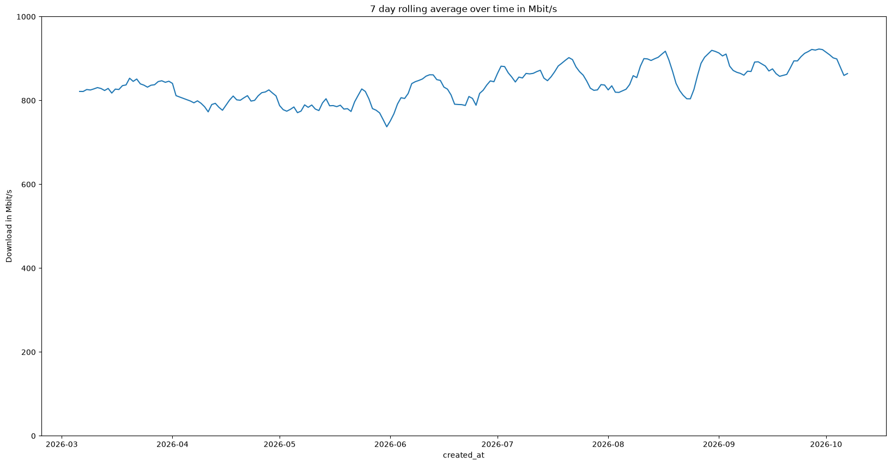
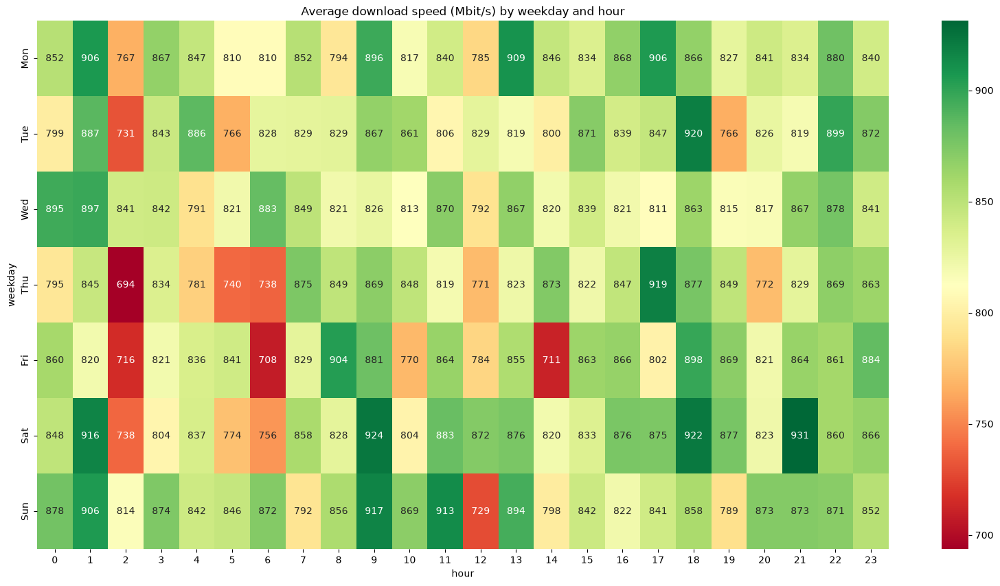

# speedtest-analysis

Analysis of about 5,000 speed tests from my home internet connection
(February to October 2026), collected hourly by a self-hosted
[Speedtest Tracker](https://github.com/alexjustesen/speedtest-tracker).

Two questions:

1. Is the connection getting better or worse over time?
2. When during the week is it slow?

The live view of the same data is a separate project,
[speedtest-dashboard](https://github.com/apathydevil/speedtest-dashboard).
This one looks at the full history. Built as a learning project for pandas
and Jupyter.

## Findings

- **Mostly full speed, with occasional deep drops.** On a 1 Gbit/s line the
  median download is 938 Mbit/s, but the mean is 839 Mbit/s: a minority of
  slow tests (some below 50 Mbit/s) pull the average down.
- **Better since summer.** The 7-day rolling average sat around 830 Mbit/s
  in March, dropped to about 740 Mbit/s at the end of May, and has stayed
  between 850 and 920 Mbit/s since July.
- **No evening rush hour, but a dip at 2:00.** Speeds are similar across
  the day. The exception is 2:00 at night, which is slower on five of seven
  weekdays (694 to 767 Mbit/s on average). The cause is not known yet.





## How it works

- `src/speedtest_analysis/fetcher.py` fetches every result from the
  Speedtest Tracker API (`/api/v1/results`), following the pagination links
  page by page. It drops failed tests and tests with missing values, and
  converts speeds to Mbit/s.
- `src/speedtest_analysis/storage.py` writes the cleaned results to
  `data/results.csv`.
- `notebooks/explore.ipynb` loads the CSV and produces the charts: all tests
  over time, a daily and 7-day rolling average, and a weekday-by-hour
  heatmap.

The API documentation lists the page size parameter as `per.page`. The
server actually reads `page[size]` (see `ResultsController` in the
Speedtest Tracker source), which brings a full fetch down from 209 requests
to 11.

## Stack

- **requests** + **python-dotenv**: API access, credentials kept in `.env`
- **pandas**: loading, grouping, rolling averages, pivot tables
- **matplotlib** + **seaborn**: charts
- **Jupyter**: exploration
- **uv**: dependency management

## Setup

Requires a running Speedtest Tracker instance and an API token from it.

```bash
uv sync
cp .env.example .env
```

Then fill in `SPEEDTEST_URL` and `SPEEDTEST_TOKEN` in `.env`.

## Run

Fetch the data (run from the project root):

```bash
uv run python -m speedtest_analysis.fetcher
```

Then open `notebooks/explore.ipynb`, select the `.venv` kernel and run all
cells.

`data/` is not committed, and the notebook is committed without outputs. The
charts above are saved in `images/`.
